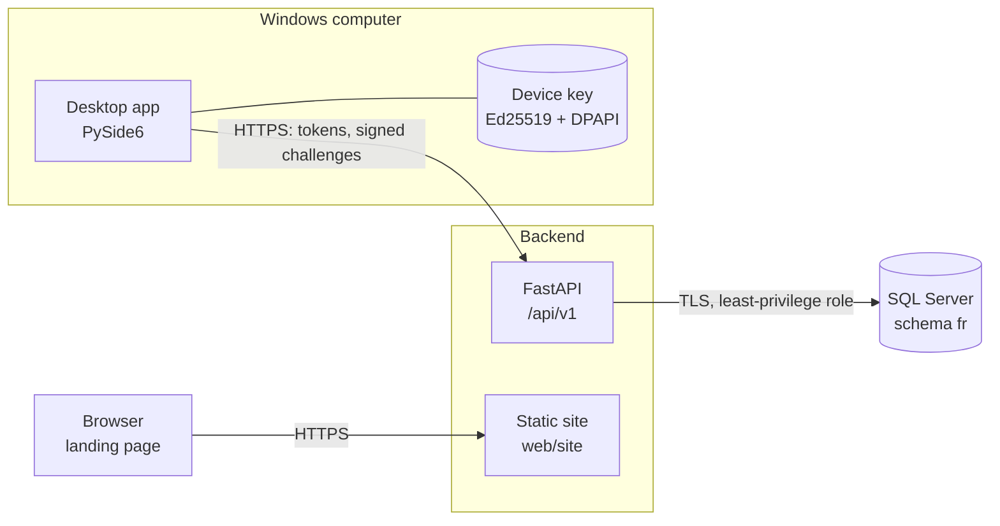

<div align="center">


# Fabulous Remote

**Consent-based remote desktop assistance for Windows: authenticated, encrypted and auditable.**


</div>

---

Fabulous Remote lets a helper connect to someone else's Windows computer **only after that person approves the request on their own screen**. Every session is tied to a signed-in account and a registered device, travels over encrypted channels, can be ended instantly by either side, and is recorded in an append-only audit trail.

> **Project status: preview, not production-ready.** Accounts, sign-in, device registration and verified presence work end to end. Connection requests, consent, screen sharing and remote control are **not implemented yet** (see [Roadmap](#roadmap)). Nothing in this repository can view or control another computer today.

## Contents

- [Features](#features)
- [Architecture](#architecture)
- [Repository layout](#repository-layout)
- [Getting started](#getting-started)
- [Desktop installer](#desktop-installer)
- [Configuration](#configuration)
- [Testing](#testing)
- [Security](#security)
- [Documentation](#documentation)
- [Roadmap](#roadmap)
- [Contributing](#contributing)
- [License](#license)

## Features

| Area | Available now | Planned |
|---|---|---|
| **Accounts** | Invitation-only accounts, Argon2id passwords, lockout and rate limits, admin invitations, bootstrap CLI | MFA, password reset, email delivery |
| **Sessions** | 10-minute access tokens, rotating refresh tokens with reuse detection, browser sessions with CSRF protection, instant logout and revocation | — |
| **Devices** | Ed25519 device keys (DPAPI-protected), server-assigned **never-reused** 9-digit Remote IDs, signed presence heartbeats, key rotation, revocation | Device-only tokens, presence WebSocket |
| **Desktop app** | Sign-in, "This device" card with real registration and Online/Offline status, Windows installer | Connection requests and consent dialog, session banner |
| **Remote assistance** | — | Consent workflow (3e), WebRTC screen sharing (6), consent-controlled remote input (7) |
| **Web** | Landing page with honest feature labels, installer download | Web portal (devices, history, revocation) |
| **Operations** | Health and readiness probes, structured logging with secret redaction, data-retention procedure | Hosted deployment, code signing |

## Architecture



- **Desktop client** (`desktop/`): Python 3.12 + PySide6. Keeps tokens in memory only, stores its device key encrypted with Windows DPAPI, and signs server challenges to prove its identity.
- **Backend** (`backend/`): FastAPI with SQLAlchemy 2.x. Services depend on repository interfaces and a unit of work; every rule that can be is also enforced by the database.
- **Database** (`database/`): SQL Server, schema `fr`, versioned T-SQL migrations with rollbacks, least-privilege roles (migrator / runtime / maintenance) and an append-only audit table.
- **Web** (`web/site/`): static landing page served by the backend with a strict Content-Security-Policy.

Media will flow peer to peer over WebRTC (DTLS-SRTP); the server never sees screen content. See [docs/ARCHITECTURE.md](docs/ARCHITECTURE.md).

## Repository layout

```
FabRemoteAccess/
├── backend/            FastAPI service: app/ (api, services, db, security, domain), tests/
├── desktop/            PySide6 client: fabremote/, packaging/ (PyInstaller + Inno Setup), tests/
├── database/           migrations/ (V0001–V0008 + rollback/), permissions/ (P001–P003, PR001), tests/
├── web/site/           Landing page (HTML, Bootstrap 5, CSS, JS)
├── tools/              Read-only database inventory tool
├── docs/               Architecture, API contracts, database design, security, status
├── run_all.py          Start server + landing page + desktop app (development)
├── run_server.py       Start the server only (development, LocalDB)
├── run_desktop.py      Start the desktop app only
└── build_installer.py  Build and publish the Windows installer
```

## Getting started

### Prerequisites

| Tool | Version | Used for |
|---|---|---|
| Windows | 10 or 11 (64-bit) | Desktop app, DPAPI, LocalDB |
| Python | 3.12 | Everything (`py -3.12`) |
| ODBC Driver for SQL Server | 18 | Database access |
| SQL Server Express LocalDB | 2019 or later | Local development and tests |
| Inno Setup | 6 | Installer build only |

### Set up

```powershell
git clone https://github.com/Safiqultuhin055/FabRemoteAccess.git
cd FabRemoteAccess
py -3.12 -m venv .venv
.\.venv\Scripts\Activate.ps1
pip install -r requirements-dev.txt
sqllocaldb create FabRemoteTest -s
```

Create and migrate a local development database (LocalDB only):

```powershell
$S = "(localdb)\FabRemoteTest"
sqlcmd -S $S -E -b -Q "IF DB_ID('FabRemotesDB_dev') IS NULL CREATE DATABASE FabRemotesDB_dev"
sqlcmd -S $S -d FabRemotesDB_dev -E -b -I -i database\permissions\P001_bootstrap_schema_and_roles.sql
Get-ChildItem database\migrations\V*.sql | Sort-Object Name | ForEach-Object { sqlcmd -S $S -d FabRemotesDB_dev -E -b -I -i $_.FullName }
sqlcmd -S $S -d FabRemotesDB_dev -E -b -I -i database\permissions\P002_grant_runtime_permissions.sql
```

### Run

```powershell
python run_all.py          # server + landing page (http://127.0.0.1:8765/) + desktop app
```

`run_server.py` always uses the local LocalDB database and ignores every `.env` file, so development runs can never reach a shared server. API documentation is at `http://127.0.0.1:8765/docs` (development only).

### Create the first administrator

```powershell
$env:PYTHONPATH = "backend"
$env:FR_DB_HOST = "(localdb)\FabRemoteTest"; $env:FR_DB_NAME = "FabRemotesDB_dev"; $env:FR_DB_ENCRYPT = "optional"
python -m app.cli bootstrap-admin --email admin@example.com
```

The command prints a one-time invitation token. Accept it with `POST /api/v1/auth/invitations/accept`, then sign in from the desktop app. Further accounts are created by administrators through `POST /api/v1/admin/invitations`.

## Desktop installer

```powershell
python build_installer.py
```

Produces `dist\installer\FabulousRemote-Setup-<version>-preview.exe` and publishes it to the landing page's **Download** button (`web\site\downloads\`, with size and SHA-256). The installer is per-user (no administrator rights), asks for the server address, and adds **no service, no auto-start and no firewall rules**.

> The preview installer is **not code-signed**; Windows SmartScreen will warn. A signing certificate is required before distribution.

## Configuration

All settings come from `FR_*` environment variables or an untracked `.env` file. See [.env.example](.env.example) for every option. Startup refuses unsafe settings: the `sa` login, relaxed TLS for a remote database, wildcard CORS, and a missing or short signing key outside development. Credentials must never be committed, logged or copied into documentation.

## Testing

```powershell
python -m pytest           # 456 tests: database, tools, backend (unit + integration), desktop
```

| Suite | Scope |
|---|---|
| `database/tests` | Migrations, rollbacks, constraints, permissions, retention, schema alignment (LocalDB) |
| `backend/tests/unit` | Configuration, logging redaction, security primitives, API envelope, site, CLI isolation |
| `backend/tests/integration` | Auth, invitations, devices, concurrency, model drift, as the least-privilege runtime role (LocalDB) |
| `desktop/tests` | API client, device identity and DPAPI, gateway against the backend's signature code, UI states (headless) |
| `tools/tests` | Read-only inventory tool |

Database tests create throw-away databases on a private LocalDB instance and **refuse to run against any other server**.

## Security

Security is a design constraint, not an add-on:

- **Consent first:** no session without approval on the target; no hidden or unattended mode.
- **Identity:** a Remote ID is an identifier, never a credential. Devices prove possession of an Ed25519 key, whose private half never leaves the device.
- **Least privilege:** separate database roles; the application cannot alter schema, delete audit records or reuse Remote IDs.
- **No secrets at rest or in logs:** Argon2id password hashes, SHA-256 token hashes, log redaction, and no screen content on the server.

Requirements, threat model, implementation status and known gaps: [docs/SECURITY.md](docs/SECURITY.md). To report a vulnerability, see [SECURITY.md](SECURITY.md).

## Documentation

| Document | Contents |
|---|---|
| [docs/ARCHITECTURE.md](docs/ARCHITECTURE.md) | Components, flows, technology choices |
| [docs/API_CONTRACTS.md](docs/API_CONTRACTS.md) | Endpoints, schemas, authentication, errors, rate limits |
| [docs/DATABASE_DESIGN.md](docs/DATABASE_DESIGN.md) | Schema, migrations, permissions, retention, setup and rollback |
| [docs/SECURITY.md](docs/SECURITY.md) | Security requirements, threat model, verified controls, gaps |
| [docs/FEATURE_STATUS.md](docs/FEATURE_STATUS.md) | Phase-by-phase status and known limitations |
| [backend/README.md](backend/README.md) · [desktop/README.md](desktop/README.md) | Component guides |
| [CHANGELOG.md](CHANGELOG.md) | What changed in each phase |

## Roadmap

| Phase | Scope | Status |
|---|---|---|
| 1 | Architecture and security baseline | ✅ Done |
| 2 | Database design, migrations, least-privilege roles | ✅ Done |
| 3a–3d | Backend foundation, data layer, authentication, device registration | ✅ Done |
| 3e | Connection requests and target-side consent | ⏳ Next |
| 3f | Audit API, security review of Phase 3 | Planned |
| 4 | Desktop client completion | 🚧 Preview |
| 5 | Web portal | 🚧 Landing page done |
| 6 | WebRTC screen sharing (view only) | Planned |
| 7 | Consent-controlled remote input | Planned |
| 8–10 | Network testing, security review, signed installer and deployment | Planned |

## Contributing

See [CONTRIBUTING.md](CONTRIBUTING.md) for the development workflow, coding conventions and the rules that keep this project safe (no shared-database access from tests, no secrets in code, tests with every change).

## License

No license has been chosen yet. Until one is added, all rights are reserved by the author: you may view the code, but you may not use, copy, modify or distribute it without permission.
