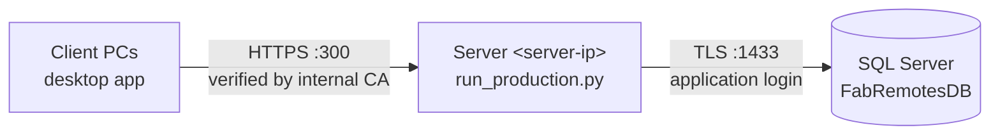

# Deploying the Fabulous Remote server (Windows, HTTPS)

This guide puts the backend (API + landing page) on a Windows server in your network, reachable at `https://<server-ip>:300`, and points the desktop clients at it. Plain `http` to another machine is refused by the app and the installer on purpose: passwords and tokens must never cross the network unencrypted.

> Placeholders: `<server-ip>` is the server's address (for example `10.1.2.3`), `<sql-host>` is the SQL Server, `<app-login>` is the application database login. Keep real addresses and passwords out of this repository.

## Overview



## 1. Prerequisites on the server

- Windows Server 2019+ or Windows 10/11, Python 3.12, ODBC Driver 18 for SQL Server.
- The project files, for example in `C:\FabulousRemote`:
  ```powershell
  git clone https://github.com/Safiqultuhin055/FabRemoteAccess.git C:\FabulousRemote
  cd C:\FabulousRemote
  py -3.12 -m venv .venv
  .\.venv\Scripts\pip install -r backend\requirements.txt
  ```

## 2. Database (DBA)

`FabRemotesDB` must be at schema version 9 (V0001–V0009, with P002 run after V0008). V0009 adds no tables, so P002 need not be re-run after it. Then:

1. Create three **dedicated logins** (never `sa`): migration, application, maintenance.
2. Map them to the roles:
   ```powershell
   sqlcmd -S <sql-host> -d FabRemotesDB -E -N -b -I -i database\permissions\P003_map_logins_to_roles.sql `
          -v MigratorLogin="<migration-login>" AppLogin="<app-login>" MaintenanceLogin="<maintenance-login>"
   ```
3. Make sure the SQL Server certificate is trusted by the app server, or pin it with `FR_DB_SERVER_CERTIFICATE`.

## 3. HTTPS certificate

Create an internal CA and a server certificate valid for the server's address. Run this once, on a trusted admin machine or on the server:

```powershell
.\.venv\Scripts\python deploy\server\make_internal_ca.py --ip <server-ip> [--dns <server-name>]
```

This writes `deploy\server\certs\` (git-ignored):

| File | Where it goes |
|---|---|
| `server.crt`, `server.key` | Stay on the server. Restrict `server.key` to the service account: `icacls deploy\server\certs\server.key /inheritance:r /grant:r "%USERNAME%:R"` |
| `ca.cer` | Every client PC (step 6) |
| `ca.key` | Move **offline** after use; it is only needed to renew the server certificate |

If your organisation has its own PKI, use a certificate from it instead (subjectAltName must contain `<server-ip>` and/or the host name), and skip the client import.

## 4. Configuration

```powershell
copy deploy\server\.env.production.example deploy\server\.env
notepad deploy\server\.env
```

Fill in: `FR_JWT_SIGNING_KEY` (generate with `python -c "import secrets; print(secrets.token_urlsafe(48))"`), `FR_PUBLIC_BASE_URL=https://<server-ip>:300`, `FR_SITE_DIR`, and the database settings with `<app-login>`. The server refuses to start with `sa`, a short signing key, or unverified database TLS to a remote server.

## 5. Firewall and start

```powershell
# As administrator, once:
New-NetFirewallRule -DisplayName "Fabulous Remote API (HTTPS 300)" -Direction Inbound -Protocol TCP -LocalPort 300 -Action Allow

# Start:
.\.venv\Scripts\python deploy\server\run_production.py --env-file deploy\server\.env --port 300
```

Check from another PC: `https://<server-ip>:300/health/ready` should return `{"status":"ready",...}`. To run it permanently, register the same command as a Windows service (for example with NSSM) or a Task Scheduler task "at system startup" under a dedicated, non-administrator account.

## 6. Client PCs

1. **Trust the internal CA** (not needed for a company-PKI certificate):
   ```powershell
   certutil -user -addstore Root ca.cer        # current user, no admin rights
   # or, for all users (administrator): certutil -addstore Root ca.cer
   ```
   Organisations can distribute `ca.cer` with Group Policy instead.
2. **Install the desktop app** and enter `https://<server-ip>:300` as the server address, or build an installer with the address pre-filled:
   ```powershell
   python build_installer.py --default-server https://<server-ip>:300 --no-publish
   ```
   Unattended install: `FabulousRemote-Setup-<version>-preview.exe /VERYSILENT /CURRENTUSER /SERVER=https://<server-ip>:300`.

The desktop app verifies the server certificate against the Windows certificate store. There is no option to switch verification off. `FR_DESKTOP_CA_BUNDLE=<path to ca.crt>` can point it at the CA file instead, for testing.

## 7. Updating and rollback

- **Update:** stop the server, `git pull`, `pip install -r backend\requirements.txt`, apply any new migration with the migration login (and re-run P002), then start again.
- **Rollback:** start the previous code version. Schema rollbacks follow [docs/DATABASE_DESIGN.md](../docs/DATABASE_DESIGN.md) §11 (they refuse once data exists; restore from backup instead).
- **Renew the certificate** before it expires (825 days): re-run `make_internal_ca.py` with the same CA folder. Clients keep working because the CA is reused.

## Security checklist

- [ ] HTTPS only; port 300 open only for the client network.
- [ ] Application database login (not `sa`); `sa` password rotated.
- [ ] `server.key` and `deploy\server\.env` readable only by the service account; `ca.key` offline.
- [ ] `FR_ENV=production` (OpenAPI docs off, HSTS on).
- [ ] Database backups scheduled before real use.
- [ ] Installer code-signed before distribution.
