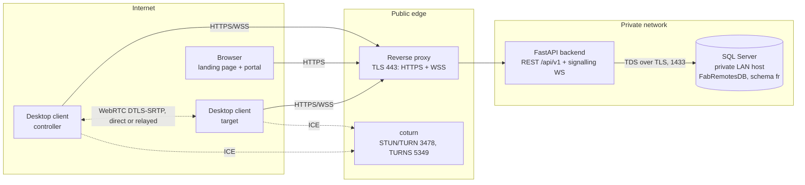
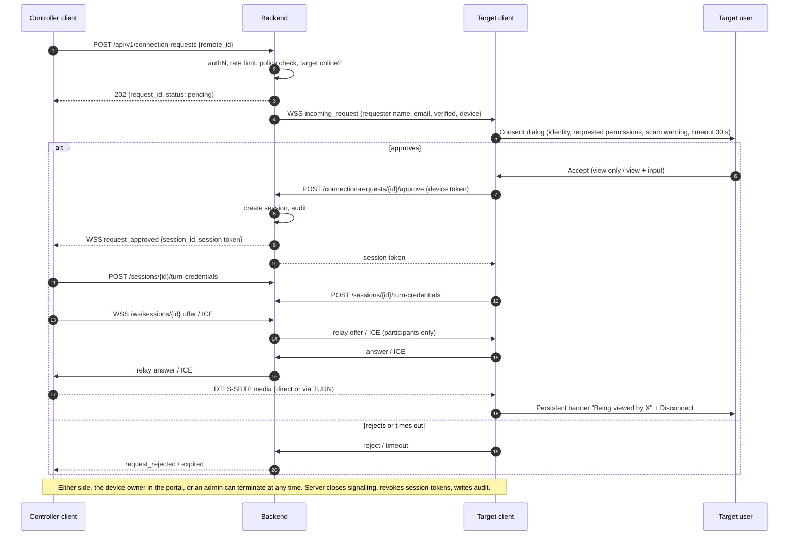

# Fabulous Remote — Architecture

Status: **proposed** (Phase 1). Nothing described here is implemented yet; see `FEATURE_STATUS.md`.

## 1. Goals and non-goals

Goals
- Attended remote assistance on Windows over LAN and the Internet.
- Every session is authenticated, authorised, consented to on the target, encrypted end to end on the media path, visible while active, and auditable.
- Maintainable, modular Python codebase with automated tests.

Non-goals (first release)
- Unattended access, file transfer, clipboard sync, remote printing, chat. Each needs its own security review before being added.
- macOS, Linux and mobile clients (roadmap only).
- Any form of hidden operation: no stealth mode, no hidden persistence, no Windows service that accepts sessions without a visible UI.

## 2. System context



Rules that follow from this picture:
- Clients never talk to SQL Server and never hold database credentials.
- The backend never sees screen content. It brokers identity, consent, signalling (SDP/ICE text) and TURN credentials only.
- Media flows peer to peer (or via TURN, which relays encrypted packets it cannot decrypt).

## 3. Components

### 3.1 Desktop client (Python 3.12 + PySide6)
| Module | Responsibility |
|---|---|
| `ui/` | Home, Recent Sessions, Favorites, Address Book, Settings, Help, login dialog, **incoming-request consent dialog**, **active-session banner with Disconnect** |
| `api_client/` | Typed REST client (httpx), token refresh, error mapping |
| `identity/` | Device key pair (Ed25519) generated on first run; private key protected by Windows DPAPI via Credential Manager (`keyring`); refresh token storage |
| `presence/` | Authenticated WSS connection to the backend; receives incoming requests and session events; reconnect with back-off |
| `rtc/` (Phase 6) | aiortc peer connection, screen capture (`mss`), viewer rendering |
| `input/` (Phase 7) | Remote input injection via Win32 `SendInput`, only during an active, consented session with input permission granted |

Async model: aiortc is asyncio-based, so the Qt event loop is bridged with `qasync`; no background threads touch Qt widgets.

### 3.2 Backend (FastAPI)
| Layer | Responsibility |
|---|---|
| `api/v1/` | Routers: health, auth, users, devices, connection-requests, sessions, turn, address-book, favorites, audit; WebSocket endpoints |
| `services/` | Business rules: consent state machine, authorisation policy, rate limits, TURN credential minting, audit writing |
| `db/` | SQLAlchemy 2.x models and repositories; engine via `mssql+pyodbc` + ODBC Driver 18 |
| `core/` | Settings (`pydantic-settings`, environment/.env), password hashing, token handling, structured logging with redaction |

Initially a **single instance** (presence and signalling routing in memory, behind an interface). Horizontal scaling later needs a shared bus (e.g. Redis pub/sub); not added until required.

### 3.3 Web (HTML5, Bootstrap 5, CSS3, vanilla JS)
- `web/site/` — landing page: features, how it works, security, Windows download, sign-in/support links. Planned features clearly marked "Planned".
- `web/portal/` — management portal: sign-in, dashboard, devices, connection history, active sessions with revoke, profile/settings, admin views behind RBAC.
- Served from the same origin as the API (behind the reverse proxy), so the portal uses **cookie sessions** and CORS can stay closed.
- No build step; Bootstrap loaded from a pinned version with Subresource Integrity, or vendored.

### 3.4 Database (SQL Server)
All objects in schema `fr`, owned by `fr_owner`. Migrations are **plain versioned T-SQL scripts** (`database/migrations/`) reviewed by the DBA and run with sqlcmd; separate migrator / runtime / maintenance roles. Full design: [DATABASE_DESIGN.md](DATABASE_DESIGN.md). (Phase 2 decision; replaces the earlier Alembic proposal.)

### 3.5 TURN (coturn)
`use-auth-secret` mode: the backend mints time-limited TURN credentials (HMAC of expiry + session ID, shared secret known only to backend and coturn). Relay port range restricted; quotas per allocation.

## 4. Identity model

| Concept | What it is | What it is **not** |
|---|---|---|
| User | Account with email, Argon2id password hash, roles | — |
| Device | A registered installation, bound to the user who registered it, holding an Ed25519 key pair | — |
| Remote ID | 9-digit public identifier assigned by the server to a device, shown as `105 280 964` | **Not a credential.** Knowing it grants only the ability to *ask*. |
| Access token | Short-lived JWT (≈10 min) for REST calls | — |
| Refresh token | Opaque random value, stored hashed, rotated on every use, reuse detection revokes the family | — |
| Device token | Issued after the device signs a server challenge with its private key; used for presence WSS | — |
| Session token | Scoped to one session ID and one participant, short-lived, required to join signalling | — |

Web portal uses server-side sessions in an `HttpOnly; Secure; SameSite=Lax` cookie plus a CSRF token on state-changing requests.

## 5. Key flows

### 5.1 Device registration
1. User signs in on the desktop client (access + refresh token).
2. Client generates an Ed25519 key pair (first run only) and sends the public key + device name + OS info.
3. Server stores the device, assigns a unique Remote ID, writes an audit event.
4. Thereafter the client authenticates as the device by signing a nonce → device token → opens the presence WSS. Only then does the UI show "Ready to connect".

### 5.2 Connection request, consent, session



### 5.3 State machines
- **Connection request:** `pending → approved | rejected | expired | cancelled` (expiry 30–60 s, configurable).
- **Session:** `authorizing → active → ended`; end reasons: `controller_disconnect`, `target_disconnect`, `revoked`, `timeout`, `error`.
- The client UI is driven only by these server states plus real ICE/peer-connection state. A "connected" state is never shown on the strength of the request alone.

## 6. Data model (schema `fr`)

Designed in Phase 2. The full design, permission model, retention rules and setup/rollback procedure are in [DATABASE_DESIGN.md](DATABASE_DESIGN.md).

| Area | Tables |
|---|---|
| Identity and access | `users`, `roles`, `user_roles`, `user_invitations`, `auth_sessions`, `auth_tokens` |
| Devices | `devices`, `device_keys`, `device_auth_challenges` |
| Consent and sessions | `blocked_requesters`, `connection_requests`, `sessions` |
| User data and audit | `address_book_entries` (favorites as a flag), `audit_events` |
| Operations | `schema_migrations`, procedure `usp_purge_expired_data` |

## 7. API outline

Full Phase 3 contracts (schemas, auth, authorisation, validation, errors, tests): [API_CONTRACTS.md](API_CONTRACTS.md).

| Area | Endpoints |
|---|---|
| Health (unversioned) | `GET /health/live`, `GET /health/ready` |
| Auth | `/api/v1/auth/*`: invitation acceptance, desktop token/refresh/logout, device binding, web login/logout + CSRF, `me` |
| Admin | `/api/v1/admin/invitations` (create, list, revoke) |
| Devices | `/api/v1/devices` (register, list, get, patch, revoke), `/devices/challenge`, `/devices/token` |
| Connection requests | `/api/v1/connection-requests` (create, get, incoming, approve, reject, cancel) |
| Sessions | `/api/v1/sessions` (list, get, terminate, permission). TURN credentials and the signalling WebSocket come in Phase 6 |
| Audit | `GET /api/v1/audit-events` (admin/auditor, read-only) |
| WebSocket | `/api/v1/ws/device` (presence + notifications, Phase 3); `/api/v1/ws/sessions/{id}` (signalling, Phase 6) |

## 8. Screen streaming approach (Phase 6)

Proof of concept: **aiortc** with an `mss`-based capture track (VP8/H.264 software encoding via PyAV), viewer renders frames into a Qt widget. Screen-only, no input.

Known risk: software encoding in Python may cap frame rate at high resolutions. Measured in Phase 6 against targets (e.g. 1080p ≥ 15 fps LAN, latency < 150 ms). Fallbacks, in order: adaptive resolution/frame rate; DXGI capture (`dxcam`) to cut capture cost; hardware encoder through PyAV; Chromium WebRTC via Qt WebEngine `getDisplayMedia`.

Remote input (Phase 7) limits to document: Windows UIPI prevents a non-elevated process injecting into elevated windows, and the UAC secure desktop is unreachable. Working around these would require a privileged service, which is out of scope until separately reviewed.

## 9. Proposed repository layout

```
FabRemoteAccess/
├─ backend/
│  ├─ app/            core/, api/v1/, services/, db/, schemas/, main.py
│  ├─ tests/
│  └─ requirements.txt
├─ desktop/
│  ├─ fabremote/      ui/, api_client/, identity/, presence/, rtc/, input/, app.py
│  ├─ tests/
│  ├─ packaging/      PyInstaller spec, Inno Setup script
│  └─ requirements.txt
├─ web/
│  ├─ site/           index.html, styles.css, app.js, assets/
│  └─ portal/
├─ database/
│  ├─ migrations/     V000N__*.sql forward scripts + rollback/R000N__*.sql
│  ├─ permissions/    P001-P003 bootstrap/grants/login mapping, PR001 teardown
│  └─ tests/          LocalDB-only migration, constraint and permission tests
├─ infra/             coturn.conf.example, reverse-proxy examples
├─ tools/             inspect_db_schema.py and other dev utilities
├─ docs/
├─ .env.example
└─ README.md
```

## 10. Technology choices

| Need | Choice | Reason |
|---|---|---|
| Python | 3.12 | Mature wheels for PySide6, PyAV/aiortc, pyodbc, PyInstaller |
| DB driver | pyodbc + ODBC Driver 18 | Supported Microsoft driver, TLS by default |
| Migrations | Versioned T-SQL scripts run with sqlcmd | DBA-reviewable, transactional, idempotent; tested on LocalDB (Phase 2 decision, replaces Alembic) |
| Password hashing | argon2-cffi (Argon2id) | Current OWASP recommendation |
| Tokens | PyJWT (access), opaque random (refresh) | Short-lived stateless access, revocable refresh |
| Settings | pydantic-settings | Typed config from env / `.env` |
| Desktop async | qasync | Single event loop for Qt and aiortc |
| Secret storage on client | keyring (Windows Credential Manager, DPAPI) | No plaintext tokens/keys on disk |
| WebRTC | aiortc | Pure-Python WebRTC with DTLS-SRTP |
| TURN | coturn | Mature, supports time-limited REST credentials |
| Tests | pytest, httpx TestClient, pytest-qt, Playwright | API, desktop UI and browser coverage |
| Packaging | PyInstaller (one-dir) + Inno Setup, signed | Per-user install, no service, standard uninstall |

## 11. Network and ports

| Port | Exposure | Purpose |
|---|---|---|
| 443/TCP | Public | HTTPS API, WSS signalling, website, portal |
| 3478/UDP+TCP, 5349/TCP | Public | STUN/TURN, TURN over TLS |
| TURN relay range (e.g. 49160–49360/UDP) | Public | Relayed media (narrow, documented range) |
| 1433/TCP | Backend host only | SQL Server; firewall must block all other sources |
| Uvicorn port (e.g. 8000) | Loopback / private | Behind reverse proxy only |
