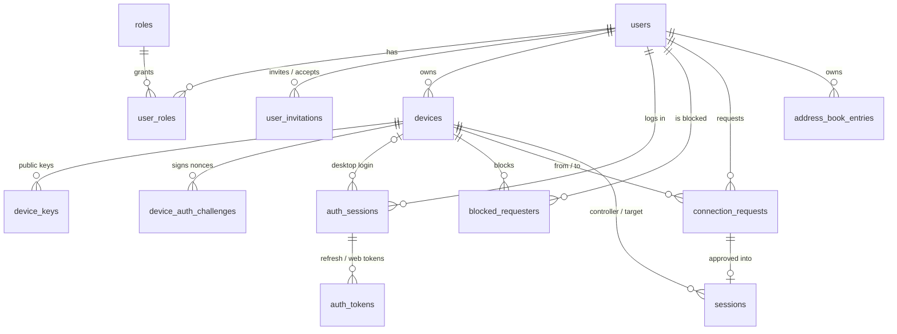

# Fabulous Remote — Database Design (Phase 2)

| | |
|---|---|
| Status | Applied to a non-production DEV environment up to version 8 (see §0). Still a draft for production. |
| Target | SQL Server, database `FabRemotesDB`, new schema **`fr`** (host configured locally in `.env`, not in documentation) |
| Scripts | [`database/permissions/`](../database/permissions/), [`database/migrations/`](../database/migrations/), [`database/migrations/rollback/`](../database/migrations/rollback/) |
| Verified on | SQL Server 2019 LocalDB (15.0.4382), private test instance `(localdb)\FabRemoteTest`; also at compatibility levels 110 (2012) and 130 (2016) on that engine |
| Review | Phase 2 safety review completed 2026-10-17; corrections listed in §15 |

## 0. Environments

The schema has been applied to a non-production DEV environment up to **version 8** (V0001–V0008), and is verified on LocalDB by the test suite. The operational deployment record (dates, verification results, open follow-ups) is kept outside this public repository.

## 1. Discovery gate

The read-only inventory (`docs/db_inventory.md`) **has not been produced yet**, so the conflict mapping in §9 is incomplete. The scripts are written so that they never assume the database is empty:

- every script verifies the state it expects and **aborts with no changes** on any mismatch (existing `fr` schema with a different owner, a pre-existing object with a planned name, a principal of the wrong type);
- nothing outside schema `fr` is created, altered or dropped, apart from three database roles and the `fr_owner` user created by P001;
- forward migrations contain no `DROP` or `TRUNCATE` statements (enforced by tests).

Schema finalisation still requires the inventory review in §9.

### 1.1 Producing the inventory (owner / DBA)

1. Edit the local, git-ignored `.env` (already created from `.env.example`; the host is pre-filled). Leave `FR_DB_USER`/`FR_DB_PASSWORD` empty to use your Windows account, or enter a **least-privilege** SQL login locally. Never `sa`. Never paste credentials into chat or tickets.
2. Certificate validation stays on. `FR_DB_TRUST_SERVER_CERT=yes` is refused for any non-local server. If the server certificate isn't trusted by this workstation:
   - preferred: the DBA installs a certificate from a trusted CA, or you import the server's CA certificate into the Windows *Trusted Root* store;
   - or pin the exported server certificate: `FR_DB_SERVER_CERTIFICATE=C:\path\server.cer` (ODBC Driver 18.1+; 18.6 is installed);
   - when connecting by IP address, set `FR_DB_HOST_NAME_IN_CERTIFICATE` to the name in the certificate.
3. Optionally set `FR_DB_EXPECTED_SERVER` to the server's `@@SERVERNAME`. The tool always checks the connected database name before reading any metadata, and aborts on a mismatch.
4. Run once (no retries on a login failure; fix the configuration first):
   ```powershell
   .\.venv\Scripts\Activate.ps1
   python tools\inspect_db_schema.py --out docs\db_inventory.md
   ```
5. Review `docs\db_inventory.md` (git-ignored) and share it, or a summary, through an internal channel.

## 2. Conventions

| Topic | Convention |
|---|---|
| Schema | All objects in `fr`, owned by `fr_owner` (a user WITHOUT LOGIN that owns nothing else) |
| Keys | `UNIQUEIDENTIFIER` with `NEWSEQUENTIALID()` default (index-friendly); `BIGINT IDENTITY` for `audit_events` |
| Timestamps | `DATETIME2(3)`, UTC, columns named `*_at`, defaults `SYSUTCDATETIME()` |
| Enumerations | `VARCHAR` + `CHECK` constraint listing the allowed values |
| Concurrency | `ROWVERSION` column `row_version` on mutable tables (optimistic locking) |
| Deletion | Users and devices are never hard-deleted by the application (status / `revoked_at`); expired data is removed only by the retention procedure |
| Constraint names | `PK_<table>`, `FK_<table>_<column>`, `UQ_<table>_<columns>`, `CK_<table>_<rule>`, `DF_<table>_<column>`; indexes `IX_<table>_…`, unique indexes `UX_<table>_…` (tests reject system-generated names) |
| Strings | `NVARCHAR` for user-visible text; emails stored lower-case (enforced by binary-collation `CHECK`) |
| Minimum server | Written for SQL Server 2012+ (avoids `CREATE OR ALTER`, `DROP IF EXISTS`, JSON functions and `STRING_AGG`), but **only verified on 2019**. Confirm the target's version and compatibility level from the inventory. |

## 3. Entity relationships



`audit_events` deliberately has no foreign keys (see §5.6). `schema_migrations` records applied versions.

## 4. Tables

### 4.1 Identity and access — V0002, V0004

| Table | Purpose | Key rules |
|---|---|---|
| `roles` | RBAC roles, seeded `user`, `admin`, `auditor` | Lower-case codes |
| `users` | Accounts | Unique lower-case email; `password_hash` must be an Argon2id PHC string (`$argon2id$…`) or NULL; `active` requires a hash; status `invited` / `active` / `disabled`; lockout fields |
| `user_roles` | User ↔ role, with who granted it | Composite PK |
| `user_invitations` | **Admin-invitation-only pilot.** Invite token stored as SHA-256 hash only | One open invitation per email (filtered unique index); accepted xor revoked; `invited_by_user_id` NULL only for the bootstrap admin |
| `auth_sessions` | One row per login (web cookie session or desktop refresh-token family) | Revocation requires a reason (`logout`, `admin_revoked`, `token_reuse`, `password_changed`, `user_disabled`, `device_revoked`) |
| `auth_tokens` | Refresh and web-session tokens, **SHA-256 hashes only** | Unique hash; `consumed_at` supports rotation and reuse detection: presenting a consumed token revokes the whole `auth_session` |

### 4.2 Devices and device identity — V0003

| Table | Purpose | Key rules |
|---|---|---|
| `devices` | Registered installations | `remote_id` is 9 digits, no leading zero, **unique across all rows including revoked devices** (never reassigned); `incoming_policy` `verified_users` / `address_book_only` / `disabled`; revocation requires timestamp + reason; `last_ip` + `last_ip_at` set together |
| `device_keys` | Device **public** keys (Ed25519, 32 bytes) and SHA-256 fingerprints | `fingerprint` is a persisted computed column (`HASHBYTES('SHA2_256', public_key)`), unique, so a key can be registered only once; at most one active key per device (filtered unique index); rotation by revoking the old row. Revoking a device must revoke its keys in the same transaction (API rule, API_CONTRACTS.md §5.3) |
| `device_auth_challenges` | Single-use nonces the device signs to obtain a short-lived device token | Unique nonce; `used_at` marks consumption |

The Remote ID is an identifier only. Device private keys never leave the device. On Windows they are protected by DPAPI via Credential Manager (see `ARCHITECTURE.md` §4).

### 4.3 Consent and sessions — V0005

| Table | Purpose | Key rules |
|---|---|---|
| `blocked_requesters` | Target device blocks a user | Composite PK |
| `connection_requests` | Every request to connect, with its outcome | `requested_permission` `view` / `view_input`; status `pending` → `approved` / `rejected` / `expired` / `cancelled`; non-pending rows must have `decided_at` and a reason **matching the status** (`approved` ↔ `target_approved`; `rejected` ↔ `target_rejected`/`blocked`/`policy_denied`; `expired` ↔ `timeout`/`target_offline`; `cancelled` ↔ `requester_cancelled`); a device cannot request itself; computed `approved_flag` supports the session link |
| `sessions` | Remote sessions, each tied **1:1** to an approved request | Composite FK `(connection_request_id, controller_user_id, controller_device_id, target_device_id, requested_permission, request_approved)` → the request's `(id, requester_user_id, requester_device_id, target_device_id, requested_permission, approved_flag)`: a session can exist **only for an approved request with the same parties**, and that request can then no longer change status; `permission_granted` ≤ `requested_permission` (CHECK); `authorizing` → `active` → `ended`; `ended` requires `ended_at` + `end_reason`; **at most one live session per target device** (filtered unique index) |

No screen content, SDP, ICE candidates, TURN credentials, access tokens or session tokens are stored.

### 4.4 Address book and audit — V0006

| Table | Purpose | Key rules |
|---|---|---|
| `address_book_entries` | User's contacts by Remote ID; favorites are entries with `is_favorite = 1` | Unique per owner + Remote ID; indexed by Remote ID for the `address_book_only` policy check (the requester's device Remote ID must be in the target owner's address book) |
| `audit_events` | Security and activity trail | `event_type` lower-case dotted (e.g. `auth.login`, `connection.requested`, `session.ended`); outcome `success` / `failure` / `denied`; optional actor, subject, IP, request ID, `details` (≤ 2000 chars, JSON by convention, **never** secrets or screen data) |

### 4.5 Retention procedure — V0007

`fr.usp_purge_expired_data` (§6).

## 5. How the requirements map to the model

| # | Requirement | Where it is enforced |
|---|---|---|
| 5.1 | No plaintext passwords | `CK_users_password_hash` accepts only Argon2id PHC strings; tokens and invites stored as SHA-256 hashes |
| 5.2 | Remote ID is not a credential | No secret columns tied to `remote_id`; device authentication uses `device_keys` + `device_auth_challenges` |
| 5.3 | Explicit target consent | A `sessions` row can only reference an **approved** request with matching requester, devices and requested permission (composite FK); `approved` requires `decision_reason = 'target_approved'` (CHECK); no permission escalation (CHECK). The API sets `approved` only on the target device's call |
| 5.4 | Revocation | `auth_sessions.revoked_*`, `auth_tokens.revoked_at` / `consumed_at`, `devices.status` / `revoked_*`, `device_keys.revoked_*`, `sessions.end_reason = 'revoked'`, `user_invitations.revoked_at` |
| 5.5 | Least privilege | §7: separate migrator / runtime / maintenance roles, object-level grants, no `sa` |
| 5.6 | Tamper-resistant audit | Runtime role can only `INSERT`/`SELECT`; `DENY UPDATE, DELETE` holds even if broader roles are granted later (tested). No FKs, so audit rows outlive the rows they describe and cannot block their removal |
| 5.7 | Personal data minimisation | IP addresses cleared after 90 days; no screen content anywhere |

## 6. Retention

> **Pending owner/legal approval.** The periods below are proposals. The procedure has **no default periods**: every call must pass them explicitly, so unapproved values can't be applied by accident. The scheduled job (Phase 3) runs only when `FR_RETENTION_ENABLED=true`, which must stay `false` outside development until the periods are approved.

`EXEC fr.usp_purge_expired_data @session_retention_days = …, @request_retention_days = …, @audit_retention_days = …, @ip_retention_days = …, @token_grace_days = …` (EXECUTE granted only to `fr_maintenance`):

| Data | Proposed | Parameter |
|---|---|---|
| Auth tokens, device challenges | 7 days after expiry/revocation | `@token_grace_days` |
| Auth sessions | 7 days after expiry/revocation, once no tokens remain | |
| Invitations | 90 days after acceptance/revocation/expiry | `@request_retention_days` |
| Ended remote sessions | 365 days | `@session_retention_days` (min 30) |
| Decided or stale connection requests | 90 days, once no session references them | `@request_retention_days` (min 30) |
| Audit events | 365 days | `@audit_retention_days` (min 90) |
| IP addresses (devices, auth sessions, requests, audit) | Cleared after 90 days | `@ip_retention_days` |

- `@dry_run = 1` is the **default**. It performs the work inside a transaction, returns exact counts and rolls back.
- `@dry_run = 0` deletes in batches (`@batch_size`, default 5000), committing per batch, and writes a `retention.purge` audit event. Interrupted runs are safe to repeat.
- Out-of-range or NULL parameters are rejected (error 51100).
- `.env.example` carries matching `FR_RETENTION_*` names and `FR_RETENTION_ENABLED=false` for the Phase 3 scheduler.

## 7. Security model

### 7.1 Identities

| Identity | Type | Used by | Can |
|---|---|---|---|
| DBA | Existing `db_owner` | Runs P001–P003, PR001 | Everything (not used by the application) |
| `fr_owner` | User WITHOUT LOGIN | Nobody — owns schema `fr` | Nothing outside `fr`. Breaks ownership chains to other schemas (tested: a view in `fr` over a `dbo` table does not leak data) |
| `fr_migrator` role | Mapped to a dedicated migration login | Deployment only | Create/alter/drop objects **in `fr` only**; read/write `fr` data for migrations; cannot touch other schemas, create users, or grant permissions |
| `fr_app_runtime` role | Mapped to the application login (`FR_DB_USER`) | Backend service | Object-level DML per §7.2; no DDL; no access outside `fr` |
| `fr_maintenance` role | Scheduled-job login (may equal the runtime login in the pilot) | Retention job | `EXECUTE fr.usp_purge_expired_data` only |

`sa` and sysadmin logins, logins that map to `dbo`, and users in any fixed database role (`db_owner`, `db_datawriter`, `db_datareader`, …) are rejected by P003.

### 7.2 Runtime permission matrix (P002)

| Object | SELECT | INSERT | UPDATE | DELETE |
|---|:-:|:-:|:-:|:-:|
| `schema_migrations` | ✓ | DENY | DENY | DENY |
| `roles` | ✓ | | | |
| `users`, `user_invitations`, `devices`, `device_keys`, `device_auth_challenges`, `auth_sessions`, `auth_tokens`, `connection_requests`, `sessions` | ✓ | ✓ | ✓ | |
| `user_roles`, `blocked_requesters` | ✓ | ✓ | | ✓ |
| `address_book_entries` | ✓ | ✓ | ✓ | ✓ |
| `audit_events` | ✓ | ✓ | DENY | DENY |
| `usp_purge_expired_data` | EXECUTE: `fr_maintenance` only | | | |

Grants are per object, never schema-wide, so a future table is invisible to the application until P002 is updated and reviewed.

### 7.3 Never stored

Plaintext passwords, raw refresh/web/invite tokens, access/device/session JWTs, TURN credentials, device private keys, SDP/ICE data, screen images or recordings, database credentials.

## 8. Migration order and expected effects

| Order | Script | Run as | Effect | Reversal |
|---|---|---|---|---|
| 0 | *Backup of FabRemotesDB* | DBA | Recovery point | Restore |
| 1 | `permissions/P001_bootstrap_schema_and_roles.sql` | DBA | `fr_owner` user, schema `fr`, 3 roles, migrator grants | `PR001` |
| 2 | `permissions/P003_map_logins_to_roles.sql` | DBA | DB users for the 3 logins, role membership | `PR001` (memberships) |
| 3 | `migrations/V0001__migration_history.sql` | migrator | `fr.schema_migrations` | `R0001` |
| 4 | `migrations/V0002__users_and_roles.sql` | migrator | `roles` (3 seed rows), `users`, `user_roles`, `user_invitations` | `R0002` |
| 5 | `migrations/V0003__devices.sql` | migrator | `devices`, `device_keys`, `device_auth_challenges` | `R0003` |
| 6 | `migrations/V0004__auth_sessions.sql` | migrator | `auth_sessions`, `auth_tokens` | `R0004` |
| 7 | `migrations/V0005__connections_and_sessions.sql` | migrator | `blocked_requesters`, `connection_requests`, `sessions` | `R0005` |
| 8 | `migrations/V0006__address_book_and_audit.sql` | migrator | `address_book_entries`, `audit_events` | `R0006` |
| 9 | `migrations/V0007__retention_procedure.sql` | migrator | `usp_purge_expired_data` | `R0007` |
| 10 | `permissions/P002_grant_runtime_permissions.sql` | DBA | Object grants/denies | Re-run after edits; removed by `PR001` |

Every migration:
- is a single transaction (`XACT_ABORT ON`): it applies completely or not at all (tested by forcing a failure halfway);
- takes an application lock, so two concurrent runs cannot interleave;
- is a no-op when its version is already recorded, and refuses to run if the previous version is missing;
- refuses to run if any object it would create already exists in `fr` (error 51003).

## 9. Conflict mapping against the existing database

**Status: pending.** `docs/db_inventory.md` does not exist yet.

When it exists, the "Fabulous Remote reserved names" section of the inventory lists every match. Review against:

| Planned name | Kind | Conflict if… |
|---|---|---|
| `fr` | schema | It exists (P001 accepts it only if owned by `fr_owner`, otherwise aborts) |
| `fr_owner`, `fr_migrator`, `fr_app_runtime`, `fr_maintenance` | principals | They exist with another type or purpose |
| `schema_migrations`, `roles`, `users`, `user_roles`, `user_invitations`, `devices`, `device_keys`, `device_auth_challenges`, `auth_sessions`, `auth_tokens`, `blocked_requesters`, `connection_requests`, `sessions`, `address_book_entries`, `audit_events`, `usp_purge_expired_data` | objects | They exist **in `fr`** (blocking). Same names in other schemas (e.g. `dbo.users`) are not blocking, because everything is schema-qualified, but they should be noted to avoid confusion. Tests cover a pre-existing `dbo.users` table |

Also take from the inventory:
- SQL Server version and compatibility level (≥ 2012 / 110 required);
- database collation (the email lower-case check uses an explicit binary collation and works under any collation);
- whether the inventory login is sysadmin or `db_owner` (it should not be, for the runtime account);
- connection encryption status.

Table names from the real database must not be copied into tracked documentation. Record conclusions here in generic terms only.

## 10. Setup procedure (for the DBA, after approval)

Prerequisites
1. A verified **full backup** of `FabRemotesDB`.
2. Three logins created by the DBA. Prefer Windows/AD accounts (no passwords to manage). For SQL logins, create them interactively (SSMS dialog, or `CREATE LOGIN` typed in a session that is not saved), with `CHECK_POLICY = ON`. Passwords never go in files, scripts or chat.
   - migration login (deployment use only)
   - runtime login (goes in the backend's `.env` / secret store)
   - maintenance login (or reuse the runtime login for the pilot)
3. Install a trusted TLS certificate on SQL Server before non-development use. Use `-C` (trust server certificate) only in development.

Commands (sqlcmd; `-E` = Windows authentication; with `-U <login>` and no `-P`, sqlcmd prompts for the password so it never appears in history):

```powershell
cd "E:\Python Project\FabRemoteAccess\database"
$S = "<server>"   # from your local configuration

# As DBA
sqlcmd -S $S -d FabRemotesDB -E -N -b -I -i permissions\P001_bootstrap_schema_and_roles.sql
sqlcmd -S $S -d FabRemotesDB -E -N -b -I -i permissions\P003_map_logins_to_roles.sql `
       -v MigratorLogin="<migration login>" AppLogin="<runtime login>" MaintenanceLogin="<maintenance login>"

# As the migration login, in order; stop at the first failure (-b)
Get-ChildItem migrations\V*.sql | Sort-Object Name | ForEach-Object {
    sqlcmd -S $S -d FabRemotesDB -U "<migration login>" -N -b -I -i $_.FullName
    if ($LASTEXITCODE -ne 0) { throw "Stopped at $($_.Name)" }
}

# As DBA
sqlcmd -S $S -d FabRemotesDB -E -N -b -I -i permissions\P002_grant_runtime_permissions.sql
```

Flags: `-b` aborts on error with a non-zero exit code; `-I` enables quoted identifiers (also set inside each script); `-N` encrypts the connection.

Verification (read-only):

```sql
SELECT version, description, applied_at, applied_by FROM fr.schema_migrations ORDER BY version;
SELECT r.name AS role_name, m.name AS member FROM sys.database_role_members rm
JOIN sys.database_principals r ON r.principal_id = rm.role_principal_id
JOIN sys.database_principals m ON m.principal_id = rm.member_principal_id
WHERE r.name LIKE 'fr[_]%';
```

Then re-run `tools/inspect_db_schema.py` with the runtime login. It should report `is_sysadmin = 0` and `is_db_owner = 0`.

## 11. Rollback

| Situation | Action |
|---|---|
| A migration failed | Nothing to do: the transaction rolled back. Fix the cause and re-run. |
| Undo the latest migration while tables are empty | Run the matching `rollback/R000N` as the migration login, newest first |
| Tables contain data | Rollback scripts **refuse** (error 51011). Restore from the pre-migration backup instead. |
| Full decommission | `R0007` … `R0001`, then `PR001` as DBA (refuses while `fr` contains objects). Drop the DB users created by P003 manually after review. |

Rollback scripts are no-ops if their version isn't applied, and refuse to run out of order (error 51010).

## 12. Tests

Run offline (LocalDB only; the fixtures refuse any server that is not LocalDB):

```powershell
sqllocaldb create FabRemoteTest -s      # once
py -3.12 -m venv .venv; .\.venv\Scripts\Activate.ps1
pip install -r requirements-dev.txt
python -m pytest
```

| Area | File |
|---|---|
| File naming, ordering, guards, no DROP / dbo / credentials / private IPs | `database/tests/test_static_checks.py` |
| Apply as migrator, idempotent re-run, order enforcement, conflict abort, mid-migration failure rollback and recovery re-run, compatibility levels 110/130, legacy objects untouched, naming, UTC types, ownership | `database/tests/test_migrations.py` |
| PK/FK/unique/CHECK rules via the runtime role, incl. session ↔ approved-request link, no escalation, status/reason pairs, fingerprint derivation | `database/tests/test_constraints.py` |
| Role separation, audit DENY, ownership-chain leak, P002/P003 guards (sa, sysadmin, shared logins, fixed-role members) | `database/tests/test_permissions.py` |
| Retention dry run, real run, batching, repeatability, parameter validation, no implicit periods | `database/tests/test_retention.py` |
| Backend domain constants equal the database CHECK values, lengths, Remote ID and event-type rules | `database/tests/test_api_alignment.py` |
| Full rollback + teardown back to original state, data-loss refusal, order enforcement | `database/tests/test_rollback.py` |
| Inventory tool: read-only queries, redaction, failure paths (mocked pyodbc); queries valid on real SQL Server | `tools/tests/test_inspect_db_schema.py`, `database/tests/test_inventory_queries.py` |

Not yet tested: behaviour on the actual target server version (compatibility levels were tested on a 2019 engine only) and collation, and real login/TLS behaviour against the shared server. These depend on the inventory and on approval.

## 13. Decisions recorded in this phase

- **Plain versioned T-SQL instead of Alembic** (changes `ARCHITECTURE.md` §3.4/§10). DBA-reviewable SQL is the source of truth. Phase 3 SQLAlchemy models will map to these tables, with a test comparing models against a migrated LocalDB to catch drift.
- `fr_owner` owns schema `fr` to prevent cross-schema ownership chaining.
- Object-level runtime grants (no schema-wide grants).
- Favorites are a flag on `address_book_entries`, not a separate table.
- Pilot rule: one live remote session per target device.
- Users and devices are soft-deleted. Account erasure (anonymisation) is a production prerequisite (§14).

## 14. Production prerequisite: account deletion and anonymisation

Not implemented. Must be designed, reviewed and tested **before production use**. It is outlined here so the schema already supports it:

| Step | Effect |
|---|---|
| Trigger | Verified request from the user or an admin decision; recorded as `user.erasure_requested` |
| Revoke | All auth sessions/tokens (`user_disabled`), all devices and keys (`user_disabled`), live sessions ended (`revoked`), open invitations revoked |
| Anonymise `users` | `email` → `deleted+<id>@invalid.local`, `display_name` → `Deleted user`, `password_hash` → NULL, `status` → `disabled` (row kept because history references it) |
| Delete user-owned data | `address_book_entries`, `blocked_requesters` entries naming the user, `user_roles` |
| Devices | `display_name` → `Removed device`, OS fields and `last_ip` cleared; `remote_id` kept, so it is never reassigned |
| Requests / sessions | Kept for the retention period without personal fields (`requester_ip` cleared) |
| Audit | Kept (UUIDs only, no names or emails, by design); IPs cleared; then removed by normal retention |
| Implementation | A procedure owned by `fr_owner`, EXECUTE granted to a dedicated role, one transaction, idempotent, with its own audit event `user.erased` |

Legal basis, response deadlines and exceptions (e.g. legal hold) are for the owner/legal team to confirm.

## 16. V0008: device registration (Phase 3d, 2026-10-18)

| Object | Purpose |
|---|---|
| `fr.remote_id_registry` (`remote_id` PK, `allocated_at`) | Permanent record of every Remote ID ever issued. No FK to devices; the runtime role may only INSERT/SELECT (DENY UPDATE/DELETE), so an ID is never reused even if a device row were removed. Back-filled from existing devices |
| `FK_devices_remote_id` | Every device must use an ID from the registry |
| `fr.device_registration_challenges` | Registration attempts bound to user, auth session and proposed public key (computed fingerprint), single use, short-lived. The runtime role may DELETE (the app purges expired rows of the user) |

- **Policy:** V0001–V0007 are applied on the shared DEV database and are **not edited**; V0008 is a new migration with rollback `R0008` (refuses once any ID is allocated, by design).
- **P002** now requires version 8 and grants the new tables; it must be re-run after V0008.
- **Verified on:** LocalDB (full test suite; local dev DB `FabRemotesDB_dev` migrated to 8).
- **Applied** to the DEV environment on 2026-10-18 (with P002 re-run); details are in the internal deployment record.

## 15. Phase 2 review corrections (2026-10-17)

| # | Defect found | Correction | Regression tests |
|---|---|---|---|
| 1 | A session could reference a request that was never approved, or whose requester/devices differ | Composite FK to `connection_requests` including computed `approved_flag`; approved requests are final once referenced | `test_session_requires_an_approved_request`, `test_session_must_match_its_request`, `test_approved_request_is_final_once_a_session_exists` |
| 2 | `view_input` could be granted for a `view` request (escalation) | `requested_permission` copied into `sessions` (FK-checked) + `CK_sessions_permission_within_request` | `test_session_cannot_grant_more_than_requested` |
| 3 | Status and decision reason could contradict (e.g. `approved` + `timeout`) | `CK_connection_requests_status_reason` | `test_request_status_and_reason_must_agree`, `test_status_reason_matrix_matches_database` |
| 4 | Fingerprint supplied by the application could disagree with the key | Persisted computed column | `test_fingerprint_is_derived_from_public_key_and_unique` |
| 5 | `[a-z]` checks on `audit_events.event_type` and `roles.code` accepted upper case under the case-insensitive collation | Binary collation in both CHECKs | `test_audit_event_values_checked`, `test_role_codes_are_lower_case`, alignment test |
| 6 | Retention procedure had built-in default periods (not yet approved) | Periods are required parameters; scheduler gated by `FR_RETENTION_ENABLED` | `test_retention_periods_have_no_defaults` |
| 7 | No index for per-target rate limits | `IX_connection_requests_target_device_id` | covered by naming/catalog tests |
| 9 | `sessions.request_approved` (part of the session → request FK) was nullable; SQL Server skips FK checks when a referencing column is NULL (found by the backend model-drift test) | `PERSISTED NOT NULL` | `test_foreign_key_columns_on_computed_values_are_not_nullable`, `test_model_drift.py` |
| 8 | Inventory tool: target not confirmed; certificate could only be validated or bypassed | Identity check before metadata; certificate pinning / host-name options; bypass limited to local servers; role-membership and version sections | `tools/tests/test_inspect_db_schema.py` |
